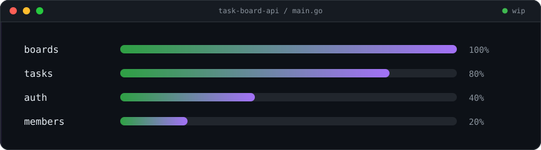

<div align="center">
  
</div>

<div align="center">
  
  
  
</div>



## ~/about

```go
type Dev struct {
	Name     string
	Role     []string
	Building string
	Learning []string
	Origin   string
}

var me = Dev{
	Name:     "Ansar",
	Role:     []string{"Full Stack", "Backend"},
	Building: "Trello-style task board API",
	Learning: []string{"Go", "REST API design", "backend architecture", "WordSkills"},
	Origin:   "Self-taught. Switched Node.js → Go mid-project, on purpose, to learn it properly.",
}
```

**Ask me about** JavaScript · React · TypeScript · Node.js · building products solo

**Looking for help with** structuring Go projects and designing auth for APIs

**Open to** collaborating on open-source developer tools and AI tools for small businesses


## ~/now



<br/>

**Go roadmap**

- [x] Port the task board from Node.js to Go
- [ ] Structure the project properly (`cmd/`, `internal/`)
- [ ] Auth: JWT + middleware
- [ ] Postgres layer
- [ ] Tests
- [ ] Docker + deploy


## ~/stack


## ~/activity

<div align="center">
  <picture>
    <source media="(prefers-color-scheme: dark)" srcset="https://raw.githubusercontent.com/ansargabit99-boop/ansargabit99-boop/output/github-snake-dark.svg" />
    <source media="(prefers-color-scheme: light)" srcset="https://raw.githubusercontent.com/ansargabit99-boop/ansargabit99-boop/output/github-snake.svg" />
    
  </picture>
</div>

<br/>

<div align="center">
  <picture>
    <source media="(prefers-color-scheme: dark)" srcset="https://github-readme-stats-five-sigma-99.vercel.app/api?username=ansargabit99-boop&show_icons=true&theme=tokyonight&title_color=2ea043&icon_color=a371f7&hide_border=true&bg_color=00000000&count_private=true" />
    <source media="(prefers-color-scheme: light)" srcset="https://github-readme-stats-five-sigma-99.vercel.app/api?username=ansargabit99-boop&show_icons=true&title_color=2ea043&icon_color=a371f7&hide_border=true&bg_color=00000000&count_private=true" />
    
  </picture>
  <picture>
    <source media="(prefers-color-scheme: dark)" srcset="https://github-readme-stats-five-sigma-99.vercel.app/api/top-langs/?username=ansargabit99-boop&layout=compact&theme=tokyonight&title_color=2ea043&hide_border=true&bg_color=00000000&langs_count=8" />
    <source media="(prefers-color-scheme: light)" srcset="https://github-readme-stats-five-sigma-99.vercel.app/api/top-langs/?username=ansargabit99-boop&layout=compact&title_color=2ea043&hide_border=true&bg_color=00000000&langs_count=8" />
    
  </picture>
</div>


## ~/contact

<a href="https://www.linkedin.com/in/ansar-gabit-0a1b38372"></a>
<a href="https://www.instagram.com/lazzyniusss/"></a>
<a href="mailto:ansargabit99@gmail.com"></a>

<br/>

<div align="center">
  <sub><code>// written by hand · ansargabit99-boop</code></sub>
</div>
